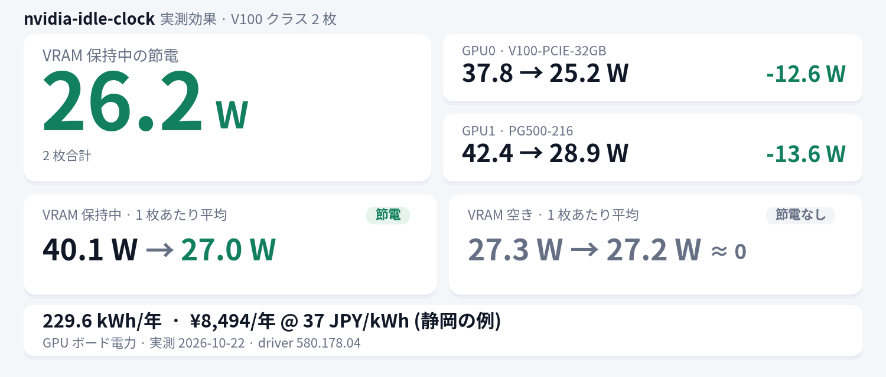

[English](README.en.md) | 日本語

# nvidia-idle-clock

VRAM に何か載ると高クロックに張り付いたままになる NVIDIA GPU 向け。
**アイドル時だけ** `nvidia-smi -lgc` でクロック上限を絞り、負荷を検出すると解除する systemd デーモンで、
GPU ごとに独立したインスタンスとして動く (依存は bash と `nvidia-smi` だけ)。

**実測: VRAM 保持中は 2 枚合計で 26.2W 節電、VRAM が空なら 0W** → [実測データ](docs/reference.ja.md#実測データ)



## クイックインストール

```bash
git clone https://github.com/kuraneko1/nvidia-idle-clock.git
cd nvidia-idle-clock
sudo ./install.sh          # 検出した全 GPU に 1 インスタンスずつ
```

確認:

```bash
systemctl status 'nvidia-idle-clock@*'
journalctl -u nvidia-idle-clock@0 -f
```

30 秒無負荷が続くと最初のクランプが入る。アンインストールは `sudo ./uninstall.sh`。

## GPU を選ぶ

引数なしなら検出した全 GPU。`sudo ./install.sh 0 1` や `sudo ./install.sh --gpus 0,2` で
index を選べる (GPU UUID も可)。GPU ごとに `nvidia-idle-clock@<index>.service` が 1 つ動き、
設定は `systemctl edit` の drop-in で変える (→ [GPU ごとの割り当て](docs/reference.ja.md#gpu-ごとの割り当て))。

## 必要なもの

- Linux + systemd
- `-lgc` が使える NVIDIA driver (Volta 以降)
- インストール時の root

共有 GPU では事前の合意が必要 (→ [共有 GPU](docs/reference.ja.md#共有-gpu))。

## ドキュメント

- [docs/reference.ja.md](docs/reference.ja.md) — 設定・CLI・動作・状態ディレクトリ・共有 GPU・先行事例・実測データ・トラブルシュート
- [docs/reference.en.md](docs/reference.en.md) — 同じ内容の英語版
- [README.en.md](README.en.md) — English quick start

## ライセンス

MIT
