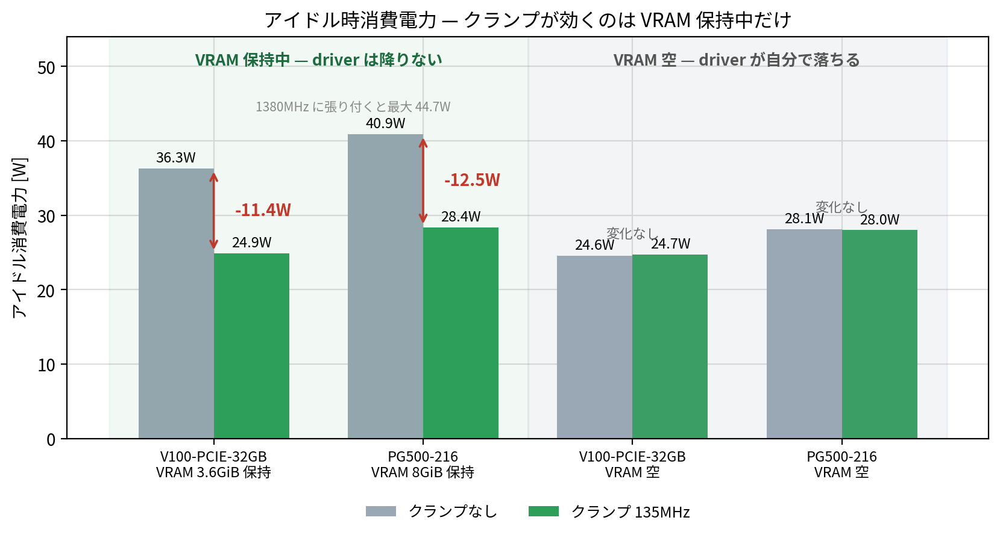
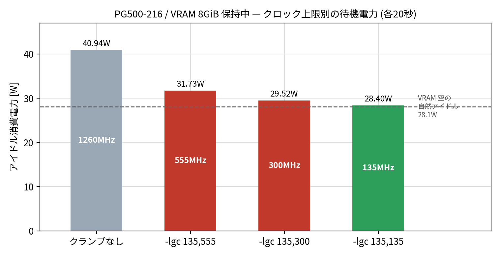
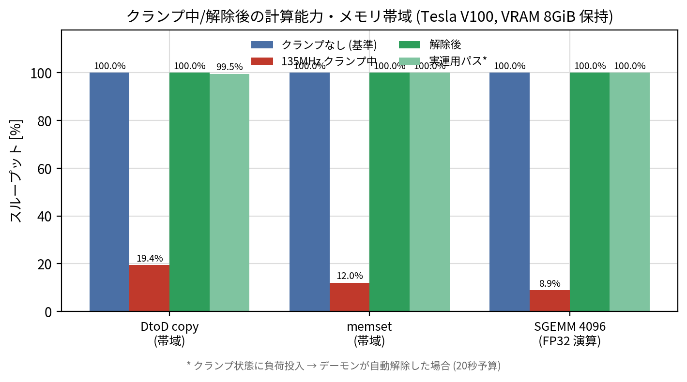

[English](README.en.md) | 日本語

# nvidia-idle-clock

VRAM に何か載ると高クロックに張り付き、アイドルでも 36〜45W 消費する NVIDIA GPU 向け。
アイドル時だけ `nvidia-smi -lgc` でクロック上限を絞り、負荷を検出すると即解除する systemd デーモン。
**GPU ごとに独立したインスタンス**として動き、1枚ずつ別々の設定を割り当てられる。

| Tesla V100-PCIE-32GB (VRAM 3.6GiB 使用) | 適用前 | 適用後 |
|---|---|---|
| アイドル消費電力 | 36.3W (最大 44.7W) | **24.9W** |
| 計算能力・メモリ帯域 (解除後) | — | **誤差 0.01% で完全復帰** |

> **V100 (Volta) では PState 強制が使えない。**
> NVAPI の `NvAPI_GPU_SetForcePstate()` は `fallback=0` で全 PState (8〜15) が `NVAPI_ERROR` を返す。
> P40/P100 向けの [nvidia-pstate](https://github.com/sasha0552/nvidia-pstate) /
> [nvidia-pstated](https://github.com/sasha0552/nvidia-pstated) は動作しない
> (`fallback=2` だと 555MHz に固定され、driver の自然アイドル 135MHz より **+3W 悪化**する)。
> そのため PState ではなくクロック範囲ロックで代用している。

## インストール

```bash
git clone https://github.com/kuraneko1/nvidia-idle-clock.git
cd nvidia-idle-clock
sudo ./install.sh          # 検出した全 GPU に 1 インスタンスずつ
sudo ./install.sh 0 1      # GPU を指定する場合
```

手動:

```bash
sudo install -m 0755 nvidia-idle-clock        /usr/local/sbin/nvidia-idle-clock
sudo install -m 0644 nvidia-idle-clock@.service /etc/systemd/system/nvidia-idle-clock@.service
sudo systemctl daemon-reload
sudo systemctl enable --now nvidia-idle-clock@0.service   # GPU 0
sudo systemctl enable --now nvidia-idle-clock@1.service   # GPU 1
```

## GPU ごとの割り当て

インスタンス名がそのまま対象 GPU (`nvidia-smi` index) になる。
任意の GPU に割り当てたい場合や、GPU ごとに違う設定にしたい場合は drop-in で上書きする。

```bash
sudo systemctl edit nvidia-idle-clock@0.service
```

```ini
[Service]
Environment=GPU=2            # 別の GPU に割り当てる
Environment=IDLE_CAP=555     # この GPU だけクランプを緩める
Environment=IDLE_SECONDS=120
```

```bash
sudo systemctl restart nvidia-idle-clock@0.service
```

例:

| インスタンス | GPU | 用途 |
|---|---|---|
| `nvidia-idle-clock@0.service` | 0 | 既定 (`IDLE_CAP=135`) |
| `nvidia-idle-clock@1.service` | 1 | drop-in で `IDLE_SECONDS=120` など |

## アンインストール

```bash
cd nvidia-idle-clock
sudo ./uninstall.sh
```

手動:

```bash
sudo systemctl disable --now 'nvidia-idle-clock@*'
sudo rm -f /etc/systemd/system/nvidia-idle-clock@.service /usr/local/sbin/nvidia-idle-clock
sudo systemctl daemon-reload
for g in $(nvidia-smi --query-gpu=index --format=csv,noheader); do sudo nvidia-smi -i "$g" -rgc; done
```

## 実測データ







| 項目 | クランプなし | 135MHz クランプ中 | 解除後 | 実運用パス\* |
|---|---|---|---|---|
| DtoD copy | 1024.7 GB/s | 198.7 GB/s | 1024.6 GB/s | 1019.7 GB/s (−0.49%) |
| memset | 1114.9 GB/s | 133.8 GB/s | 1114.9 GB/s | 1114.8 GB/s (−0.01%) |
| SGEMM 4096 (FP32) | 12.36 TFLOP/s | 1.10 TFLOP/s | 12.36 TFLOP/s | 12.36 TFLOP/s (±0%) |

\* クランプ状態に負荷投入 → デーモンが自動解除した場合 (20秒予算)

計測環境: Tesla V100-PCIE-32GB + Tesla PG500-216 (GV100 32GB x2) / driver 580.178.04

### 参考: 実機の出力

```
$ nvidia-smi --query-gpu=index,name,clocks.gr,power.draw --format=csv
index, name, clocks.current.graphics [MHz], power.draw [W]
0, Tesla V100-PCIE-32GB, 135 MHz, 24.94 W
1, Tesla PG500-216,       135 MHz, 27.67 W

$ journalctl -u nvidia-idle-clock@0 -o cat
01:41:02 開始 gpu=0 cap=135-135MHz idle=30s sample=200ms skip_if_low=1
01:41:37 gpu0 アイドル 30s 継続 (1380MHz): 135-135MHz にクランプ
01:44:10 gpu0 活動検出 (util=58%): ロック解除
```

## 設定

インスタンスごとに `Environment=` で指定する。`%i` (インスタンス名) が既定の GPU。

| 変数 | 既定 | 説明 |
|---|---|---|
| `GPU` | `%i` | 対象 GPU (nvidia-smi index, カンマ区切り可) |
| `IDLE_CAP` | `135` | アイドル時にクランプする上限クロック MHz |
| `MIN_CLK` | `135` | 下限クロック MHz |
| `IDLE_SECONDS` | `30` | この秒数無負荷でクランプ |
| `SAMPLE_MS` | `200` | 利用率サンプリング間隔 ms |
| `UTIL_THRESHOLD` | `0` | これ以下の利用率をアイドルとみなす % |
| `REASSERT_SECONDS` | `30` | クランプ再適用の間隔 s |
| `SKIP_IF_LOW` | `1` | 既に低クロックでアイドル中の GPU にはクランプしない |

`GPU` に存在しない index を指定した場合は除外して警告を出す。全部無効なら起動に失敗する。

## 動作

- 対象 GPU の利用率を `SAMPLE_MS` 間隔で監視 (インスタンスごとに独立)
- `IDLE_SECONDS` 無負荷 → `nvidia-smi -i N -lgc MIN_CLK,IDLE_CAP`
- 利用率 > `UTIL_THRESHOLD` → 即 `-rgc`
- `SKIP_IF_LOW=1` のとき既に低クロックなら何もしない (VRAM が空の GPU に当てると逆に +0.7〜2W)
- 利用率ストリームが切れたら 2 秒後に再接続
- 停止時は必ず `-rgc`

## 注意

- クランプ中は計算 0.089倍 / 帯域 0.12〜0.19倍まで落ちる。負荷検出は最速 `SAMPLE_MS`。
- P40/P100 のように `-lgc` より PState 強制が効く世代では
  [nvidia-pstate](https://github.com/sasha0552/nvidia-pstate) の方が有効 (45W → 10W)。
- `-rgc` はロックを外すだけで、アイドル中はクロックを上げない (次の利用時に上がる)。

## ライセンス

MIT
