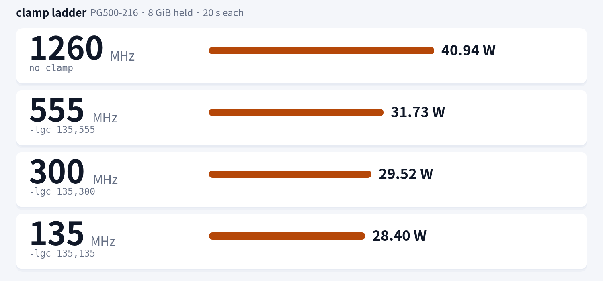
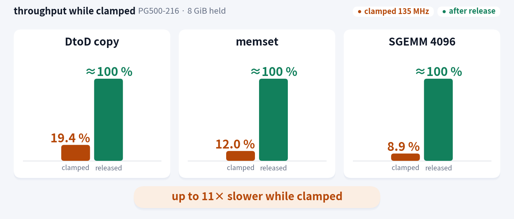

[← Back to README](../README.en.md)

# nvidia-idle-clock reference

English | [日本語](reference.ja.md)

The long reference moved out of the README. For the quick install alone, see [README](../README.en.md).

## Contents

- [Overview](#overview)
- [How it differs from stock](#how-it-differs-from-stock)
  - [What you can observe](#what-you-can-observe)
  - [What does not change](#what-does-not-change)
  - [Cost](#cost)
- [Requirements (details)](#requirements-details)
- [Supported hardware](#supported-hardware)
- [Installer options](#installer-options)
  - [Manual install](#manual-install)
- [Daemon command line](#daemon-command-line)
- [Per-GPU assignment](#per-gpu-assignment)
- [Uninstall](#uninstall)
- [Measurements](#measurements)
  - [Idle power](#idle-power)
  - [Clamp ladder](#clamp-ladder)
  - [Performance impact](#performance-impact)
  - [Sample log](#sample-log)
- [Configuration](#configuration)
- [State directory and exclusion](#state-directory-and-exclusion)
- [Behaviour](#behaviour)
- [Notes](#notes)
- [Troubleshooting](#troubleshooting)
- [Shared GPUs](#shared-gpus)
- [Prior art / related work](#prior-art--related-work)
- [License](#license)

## Overview

For NVIDIA GPUs that park at a high clock and never come down while something sits in VRAM.
A systemd daemon that clamps the clock ceiling with `nvidia-smi -lgc` **only while idle**,
and releases it when load appears. It runs **one independent instance per GPU**,
so each card can have its own settings.
The only required dependencies are bash and `nvidia-smi` — no NVAPI, no CUDA toolkit, no build step.

| State | No clamp | Clamped @135MHz | Saving |
|---|---|---|---|
| V100-PCIE-32GB / ~31GiB in VRAM | 37.85W | **25.22W** | **−12.63W** |
| PG500-216 / ~31GiB in VRAM | 42.43W | **28.85W** | **−13.58W** |
| VRAM empty | 25.50W / 29.20W | 25.45W / 28.97W | −0.05W / −0.23W (noise) |

4 × 600s samples (n≈1060–1067 per GPU, stdev 0.05–0.33W, `utilization.gpu` 0.0 in every
sample). The older 3.6GiB / 8GiB-held runs measured 36.3W → 24.9W / 40.9W → 28.4W, and a
repeat run 25.1W / 28.5W, consistent with the values above. See [Measurements](#measurements) for the
conditions and raw numbers.

> **It only helps while VRAM is held.**
> With VRAM empty the driver comes down to 135MHz by itself, so the clamp makes no difference
> (measured delta: 0.05W / 0.23W, i.e. noise). Conversely, **while VRAM is held the driver never
> comes down** — PG500-216 (GPU1) + 8GiB stayed at 1260MHz / 40–41W for a full **180 seconds**.
> That is the only case this tool targets. The default idle step differs per board
> (measured: GPU0 1230MHz, GPU1 1260MHz).
> Compute and memory bandwidth are **restored to within 0.01%** after the clamp is released
> (measured on PG500-216 with 8GiB held).

> **P-State forcing does not work on V100 (Volta).**
> On our test rig (driver **580.178.04**) NVAPI `NvAPI_GPU_SetForcePstate()` returns `NVAPI_ERROR`
> for every P-State (8–15) with `fallback=0`. The limitation was already analysed upstream in
> [nvidia-pstated issue #6](https://github.com/sasha0552/nvidia-pstated/issues/6) (January 2025),
> together with V100 measurements.
> The released [nvidia-pstate](https://github.com/sasha0552/nvidia-pstate) /
> [nvidia-pstated](https://github.com/sasha0552/nvidia-pstated) **v1.0.9 (2025-08-30)** only force
> P-States and do not work on V100 (on the same rig, `fallback=2` just pins the GPU to 555MHz,
> **+3W worse** than the driver's natural 135MHz idle). Clock locking for single-P-State GPUs is
> proposed in nvidia-pstated [PR #10](https://github.com/sasha0552/nvidia-pstated/pull/10)
> (still open as of 2026-10-22). Hence a clock-range lock instead of P-State forcing.

## How it differs from stock


| | Stock (driver-managed) | With this daemon |
|---|---|---|
| Clock while VRAM held and idle | stays at 1230–1380MHz (GPU0 1230 / GPU1 1260MHz), never drops | **135MHz** (after 30s idle) |
| Power in that state | 37.9–42.4W | **25.2–28.9W** |
| When load arrives | runs as-is | detected on the next sample, then `nvidia-smi -rgc` spawn and driver ramp: ≤0.5s in the timeline figure, 0.18–0.22s to reach 1300MHz measured in-kernel |
| 30s after load stops | still at the high clock | back to 135MHz |
| Load returns right after a release | — | not re-clamped for `COOLDOWN_SECONDS` (default 60s); releases are never delayed |
| When VRAM is empty | driver drops to 135MHz by itself | **does nothing** (same) |
| P-State | stays P0 | stays P0 (unchanged) |

### What you can observe

The only externally visible difference is `clocks.current.graphics` reading 135MHz.
`PState` stays P0, `clocks.max.graphics` stays 1380MHz, and the `-lgc` lock never shows up in the report.

```
$ nvidia-smi --query-gpu=index,pstate,clocks.gr,clocks.max.gr,power.draw --format=csv
index, pstate, clocks.current.graphics [MHz], clocks.max.graphics [MHz], power.draw [W]
0, P0, 135 MHz, 1380 MHz, 25.22 W
1, P0, 135 MHz, 1380 MHz, 28.85 W
```

(One sample at one point in time, clamped with `IDLE_CAP=135`.)

### What does not change

- P-State (V100 is always P0)
- Process VRAM, CUDA contexts, numerical results
- persistence mode, power limits, PCIe link, fan control
- Maximum clock (returns to 1380MHz once released; on stop only the GPUs **this instance clamped**
  get `-rgc`, which *resets to the default* rather than restoring a previous lock — with VRAM
  still held the clock is back at the driver-managed value within seconds, see [Notes](#notes))

### Cost

**Release latency** is the next sample period plus the `nvidia-smi -rgc` spawn plus the driver's
clock ramp, and it has no hard upper bound. At the defaults (`SAMPLE_MS=200`):

| Item | Measured |
|---|---|
| Sample period | mean 200.7 / 201.1ms, max 207.6ms (24 samples) |
| `nvidia-smi -rgc` spawn | 30–50ms (5 runs) |
| Release → 1300MHz | 180 / 215 / 215ms (3 trials) |
| Timeline figure annotation | within 0.5s |

So at the defaults it takes **0.2–0.5s**, and it grows linearly with `SAMPLE_MS`.
NVML reports utilization as a [windowed average](https://docs.nvidia.com/deploy/nvml-api/index.html)
of 1/6s to 1s, so on a product with the 1s window the worst case is about 1.2s.

**A short request runs at 135MHz for that entire window.** While clamped, compute is 0.089x
(~11x slower), so a request that finishes before the release completes pays the full penalty.
Measuring the SM clock from inside the kernel: work launched while clamped ran at 126–127MHz for
its first 80 / 95 / 110ms (three trials) and only reached 1300MHz after 180 / 215 / 215ms. A 0.5s
workload spent 185ms of its 500ms (37%) at 126MHz.

- The 20s benchmark averages below (−0.49%) dilute that 0.2–0.5s stall. Judge the impact by the
  latency numbers above, not by the aggregate.
- A GPU that never goes 30s without load is never clamped. But request-driven servers do have
  >30s gaps: on our live inference box the clamp engaged **141 times in 24h**. Raise
  `IDLE_SECONDS` (e.g. `120`) if you do not want that.
- The daemon itself costs about **380 CPU-seconds/day/instance** (~0.44% of one core) and
  17–23MB RSS, most of it the `SAMPLE_MS=200` poller.

## Requirements (details)

- Linux + systemd (the template unit `nvidia-idle-clock@.service` is used)
- NVIDIA driver and `nvidia-smi`, with `-lgc` / `-rgc` available (`nvidia-smi -h` lists `-lgc`)
- Volta or newer (sm70+); `-lgc` only exists from Volta on
- root (`-lgc` / `-rgc` are root-only)
- bash 4.2+, coreutils, and util-linux `flock` (optional: without it the daemon warns and only
  the per-GPU exclusion is disabled). Nothing else — no NVAPI, no CUDA toolkit, no build step

## Supported hardware

| GPU | Status |
|---|---|
| Tesla V100-PCIE-32GB (sm70) | **Verified** — latency measurements and idle power (37.85W → 25.22W, ~31GiB held in VRAM) |
| Tesla PG500-216 (GV100 32GB, sm70) | **Verified** — clamp ladder, performance measurements and idle power (42.43W → 28.85W, ~31GiB held in VRAM) |
| Tesla V100-SXM2 / V100-PCIE-16GB | Unverified (same sm70 with the same 135MHz floor, but not tested on hardware) |
| Other sm70 parts (Quadro GV100 etc.) | Unverified |
| Newer than Volta (Turing / Ampere / Ada / Hopper) | **Unsupported** — `-lgc` exists, but this project has not been tested on them (the saving is unverified too) |
| Older than Volta (Pascal etc.) | **Unsupported** — `nvidia-smi` has no `-lgc` |

The daemon validates the requested clock range at startup and refuses to start if `IDLE_CAP`
exceeds that GPU's `clocks.max.gr`. If `-lgc` is rejected at runtime it warns with the driver's
error and retries with backoff instead of pretending to have clamped. The default `IDLE_CAP` /
`MIN_CLK` of 135MHz is the V100 floor — set it to the real floor on other cards.

## Installer options

Install from the [README quick start](../README.en.md#quick-install).

**Do not use this on a shared GPU without agreement** (`-lgc` affects the whole card — see
[Shared GPUs](#shared-gpus)).

### Manual install

```bash
sudo install -m 0755 nvidia-idle-clock          /usr/local/sbin/nvidia-idle-clock
sudo install -m 0644 nvidia-idle-clock@.service /etc/systemd/system/nvidia-idle-clock@.service
sudo systemctl daemon-reload
sudo systemctl enable --now nvidia-idle-clock@0.service   # GPU 0
sudo systemctl enable --now nvidia-idle-clock@1.service   # GPU 1
```

`install.sh` parses its own options instead of treating argv as GPU names.

| Option | Effect |
|---|---|
| `-h`, `--help` | print usage and exit |
| `-V`, `--version` | print the installer version and the daemon sha256, exit |
| `-n`, `--dry-run` | print every action without writing anything (does not need root) |
| `--force` | skip the source-tree trust check only |
| `--gpus LIST` | GPU list, comma or space separated (may be repeated) |
| `--` | treat every following argument as a GPU |
| `[GPU ...]` | `nvidia-smi` index, GPU UUID or MIG identifier |

`uninstall.sh`:

| Option | Effect |
|---|---|
| `-h`, `--help` | print usage and exit |
| `-n`, `--dry-run` | print every action without changing anything |
| `--keep-clocks` | remove the units and files but keep the clock limit; the daemon's stop path and `ExecStopPost --unlock` skip `-rgc` (see below) |

With `--keep-clocks`, `uninstall.sh` writes `${STATE_DIR:-/run/nvidia-idle-clock}/keep-clocks`
before it stops the units. The daemon's stop path and the unit's `ExecStopPost --unlock` respect
that marker: they skip `-rgc` and leave the `gpu<N>.locked` markers in place, and the stop still
counts as successful. The clamp therefore survives the uninstall until reboot or an explicit
`nvidia-smi -rgc`; a failed uninstall removes the keep-clocks marker. `uninstall.sh`
honours `STATE_DIR` as well, so a non-default state directory behaves the same way.

Both validate before writing. The `install.sh` preflight checks the required commands
(`nvidia-smi`, `systemctl`, `install`, `sha256sum`, `stat`, `cp`, `cmp`, `date`), that systemd is
running, and that the payload files exist; an argument error exits 2 and an environment error
exits 1, in both cases **before anything is written**. Once writing has started, a failure runs
the rollback: newly created files are removed and replaced files are restored from a timestamped
backup (`<path>.bak.<YYYYMMDDTHHMMSS>`).

- Replacing an existing file always leaves a `.bak.<timestamp>` copy (a second install within the
  same second adds the PID).
- Instances that were already active are switched to the new code with `systemctl try-restart`
  only when the payload changed. A failed restart is reported with exit 1 but the installed units
  are kept.
- A checkout used for a root install must be owned by root or by the user running sudo, must not
  be world writable, and must not be group writable through a shared group; otherwise it is
  refused without `--force` (nothing is written).
- `uninstall.sh` leaves the files in place when a unit cannot be stopped (a running daemon must
  not be left without its unit). After removal it verifies that the files are gone and checks the
  `-rgc` result (`--keep-clocks` skips the release).

## Daemon command line

```
usage: nvidia-idle-clock [-h|--help] [-V|--version] [-n|--dry-run] [-u|--unlock]
```

| Option | Effect |
|---|---|
| `-h`, `--help` | print usage and exit |
| `-V`, `--version` | print `nvidia-idle-clock 0.2.4` and exit |
| `-n`, `--dry-run` | validate the configuration, print the resolved plan and exit; never calls `-lgc` / `-rgc` |
| `-u`, `--unlock` | release only the GPUs that carry a state marker and exit (see below) |
| none | run the daemon in the foreground (systemd `Type=simple`) |

`--help` / `--version` are handled before configuration validation; `--dry-run` runs after
validation and GPU resolution but before the first `-lgc` / `-rgc`. Unknown options and positional
arguments print `level=error msg="unknown argument"` plus the usage line on stderr and exit **2**.

`--unlock` is the recovery path for a clamp that outlived its daemon (SIGKILL, OOM,
`TimeoutStopSec`); the unit runs it as `ExecStopPost`. It runs `-rgc` only for target GPUs that
carry `$STATE_DIR/gpu<N>.locked` and removes each marker it released. When
`${STATE_DIR}/keep-clocks` exists (the uninstaller's `--keep-clocks`), it releases nothing, leaves
the markers in place and still exits 0. Nothing to do is exit 0; a failed `-rgc` is exit 1.
A GPU whose `flock` is held by a live instance is skipped with
`level=warn msg="gpu managed by another instance"`. It does not run the `clocks.max.gr` check
because it only releases.

```
$ nvidia-idle-clock --dry-run
level=info msg="dry run" gpu=0 min_mhz=135 cap_mhz=135 idle_s=30 sample_ms=200 nvidia_smi=/usr/bin/nvidia-smi state_dir=/run/nvidia-idle-clock
level=info msg="would clamp when idle" gpu=0 after_idle_s=30 util_threshold_pct=0 min_mhz=135 cap_mhz=135 skip_if_low=1 cooldown_s=60
level=info msg="would unlock on use or exit" gpu=0 trigger=util,exit,startup only_if_marked=1
```

Exit status:

| Code | Meaning |
|---|---|
| `0` | clean stop (SIGTERM / SIGINT), or `--help` / `--version` / `--dry-run` / `--unlock` succeeded |
| `1` | runtime failure (no usable GPU, `nvidia-smi` missing, stalled stream, unlock failed, ...) |
| `2` | invalid configuration or unknown argument |
| `3` | the GPU is already managed by another instance (nothing was touched) |

Configuration is validated before any GPU is touched: an invalid value logs
`level=error msg="invalid config"` and exits 2, a missing `nvidia-smi` exits 1. Exit 3
(`msg="gpu already managed"`) is a configuration mistake, so the unit sets
`RestartPreventExitStatus=3` and does not restart-loop it.

## Per-GPU assignment

The instance name is the target GPU (`nvidia-smi` index).
To assign an instance to an arbitrary GPU, or to give one GPU different settings, use a drop-in:

```bash
sudo systemctl edit nvidia-idle-clock@0.service
```

```ini
[Service]
Environment=GPU=2            # assign to another GPU
Environment=IDLE_CAP=555     # relax the clamp for this GPU only
Environment=IDLE_SECONDS=120
```

```bash
sudo systemctl restart nvidia-idle-clock@0.service
```

**Do not point `GPU=` at a GPU that another instance already uses.** The card is excluded with
`flock`; a second instance logs `level=error msg="gpu already managed"` and exits **3**
(`RestartPreventExitStatus=3`, so it does not restart-loop). By default the instance name *is*
the GPU index, so this cannot happen by accident.

Example:

| Instance | GPU | Notes |
|---|---|---|
| `nvidia-idle-clock@0.service` | 0 | default (`IDLE_CAP=135`) |
| `nvidia-idle-clock@1.service` | 1 | drop-in with `IDLE_SECONDS=120`, etc. |

## Uninstall

```bash
cd nvidia-idle-clock
sudo ./uninstall.sh
```

Manual:

```bash
sudo systemctl disable --now 'nvidia-idle-clock@*'
sudo rm -f /etc/systemd/system/nvidia-idle-clock@.service /usr/local/sbin/nvidia-idle-clock
sudo systemctl daemon-reload
for g in $(nvidia-smi --query-gpu=index --format=csv,noheader); do sudo nvidia-smi -i "$g" -rgc; done
```

## Measurements

Rig: Tesla V100-PCIE-32GB + Tesla PG500-216 (GV100 32GB x2) / driver 580.178.04 / no NVLink.
20s averages unless stated otherwise. Power is the GPU board sensor (`power.draw`), so PSU
losses, CPU and disks are excluded. The older "VRAM held" runs used a CUDA context holding
3.6GiB / 8GiB. The new A/B measurement had an inference server holding ~31GiB/GPU (the GPUs
themselves were idle).

Over a 26h production run the clamp was held 77.6% / 71.0% of the time (GPU0 / GPU1),
with 141 clamp events in 24h.

### Idle power

Effectiveness depends on VRAM state.


**Method.** 4 × 600s samples, `nvidia-smi --loop-ms=500`, first 60s dropped. n≈1060–1067
samples per GPU, stdev 0.05–0.33W. `utilization.gpu` was 0.0 (mean and maximum) in every
sample — the GPUs were idle, the LLM server only held VRAM. A1/A2 and B1/B2 are adjacent pairs
on the same board, so thermal drift cancels.

| State | GPU0 (V100-PCIE-32GB) | GPU1 (PG500-216) | Combined |
|---|---|---|---|
| VRAM held (~31GiB/GPU), clamped 135MHz (A1) | 25.22W | 28.85W | 27.04W |
| VRAM held, no clamp (driver 1230/1260MHz) (A2) | 37.85W | 42.43W | 40.14W |
| **Saving while VRAM is held** | **12.63W** | **13.58W** | **26.21W** |
| VRAM empty, no clamp (B1) | 25.50W | 29.20W | 27.35W |
| VRAM empty, clamped (B2) | 25.45W | 28.97W | 27.21W |
| **Saving while VRAM is empty** | **0.05W** | **0.23W** | **0.28W ≈ 0 (noise)** |

- **Only the VRAM-held case saves anything.** With VRAM empty the driver drops to 135MHz by
  itself, so the clamp makes no difference (0.05W / 0.23W is noise). While VRAM is held the
  driver never comes down, which is the only case this tool targets.
- The measured default idle step differs per board (GPU0 1230MHz, GPU1 1260MHz). "1260MHz" is
  the GPU1 (PG500-216) value, not something that applies to both cards.
- Held for a full year, the combined 26.21W saving is **229.6kWh/year**. At idle duties of
  25/50/75/100% that is **57.4 / 114.8 / 172.2 / 229.6kWh/year**.
- At **37 JPY/kWh** — the Chubu Electric Power 従量電灯B marginal rate for the 300kWh+ tier
  including the fuel-cost adjustment and the renewable surcharge, effective 2026-11-01 — that
  is about **8,494 JPY/year**. At the 32.89 JPY/kWh rate through 2026-10-31 it is
  **7,551 JPY/year**. This is a Shizuoka example and the fuel-cost adjustment changes monthly.
- Conditions: driver 580.178.04, two V100-class boards, no NVLink, GPU board power only
  (PSU losses, CPU and disks are excluded). The figures are the delta of adjacent same-board
  pairs.

### Clamp ladder

(PG500-216 / 8GiB in VRAM, 20s each)



| Clamp | Actual clock | Power |
|---|---|---|
| none | 1260 MHz | 40.94 W |
| `-lgc 135,555` | 555 MHz | 31.73 W |
| `-lgc 135,300` | 300 MHz | 29.52 W |
| `-lgc 135,135` | 135 MHz | 28.40 W |

### Performance impact

(PG500-216 / 8GiB in VRAM)



| Test | No clamp | Clamped @135MHz | After release | Realistic path\* |
|---|---|---|---|---|
| DtoD copy | 1024.7 GB/s | 198.7 GB/s | 1024.6 GB/s | 1019.7 GB/s (−0.49%) |
| memset | 1114.9 GB/s | 133.8 GB/s | 1114.9 GB/s | 1114.8 GB/s (−0.01%) |
| SGEMM 4096 (FP32) | 12.36 TFLOP/s | 1.10 TFLOP/s | 12.36 TFLOP/s | 12.36 TFLOP/s (±0%) |

\* load injected while clamped, daemon auto-releases (20s budget)

> **Which board these runs used.** Every 8GiB-held run is on the **PG500-216** (GV100 32GB) — the
> clamp-ladder and performance figures come from that run, while the idle A/B is the 2026-10-22
> measurement.

### Sample log

journald adds the timestamp, the script does not print one. One cycle at the defaults
(`IDLE_SECONDS=30`, `SAMPLE_MS=200`, `COOLDOWN_SECONDS=60`):

```
$ journalctl -u nvidia-idle-clock@0 -o cat
level=info msg="no stale clamp markers" gpu=0 state_dir=/run/nvidia-idle-clock
level=info msg="started" gpu=0 min_mhz=135 cap_mhz=135 idle_s=30 sample_ms=200 util_threshold_pct=0 reassert_s=30 skip_if_low=1 cooldown_s=60 state_dir=/run/nvidia-idle-clock nvidia_smi=/usr/bin/nvidia-smi
level=info msg="clamp verified" gpu=0 trigger=idle was_mhz=1230 observed_mhz=135 min_mhz=135 cap_mhz=135
level=info msg="unlocked" gpu=0 trigger=util util_pct=42
level=info msg="clamp delayed" gpu=0 reason=cooldown remaining_s=30 cooldown_s=60
level=info msg="exit" gpu=0 rc=0
# unit ExecStopPost (--unlock)
level=info msg="unlock done" gpu=0 released=none rc=0
```

Recovery when a clamp was left behind:

```
# run by the unit's ExecStopPost on stop (--unlock)
level=info msg="unlocked" gpu=0 trigger=unlock
level=info msg="unlock done" gpu=0 released=0 rc=0

# marker still present when the next instance starts
level=info msg="stale clamp markers found" gpu=0 state_dir=/run/nvidia-idle-clock action=release
level=info msg="unlocked" gpu=0 trigger=startup
```

When a second instance tries to manage the same GPU:

```
level=error msg="gpu already managed" gpu=1 hint="another instance holds /run/nvidia-idle-clock/gpu1.lock"
```

- `level=` and `msg="..."` are the first two fields. `msg` is a stable identifier, so grep for
  `msg="..."`, never for free text.
- `level=` is not a syslog priority, so `journalctl -p warning` will not filter on it; use
  `journalctl -u nvidia-idle-clock@0 -g 'level=(warn|error)'`.
- The daemon's own last line is `msg="exit" rc=0`; the unit's `ExecStopPost` (`--unlock`) then
  logs `msg="unlock done"`. If the release failed, `msg="unlock failed"` is followed by
  `msg="exit" rc=1`.
- `msg="gpu already managed"` is exit 3; the unit sets `RestartPreventExitStatus=3` so it does not
  restart.
- `msg="clamp delayed"` is the normal `COOLDOWN_SECONDS` suppression, not an error.
- `was_mhz` is the board's default idle clock (measured: GPU0 1230MHz, GPU1 1260MHz). It differs
  per board, so do not assume a single 1260MHz value.

## Configuration

Set `Environment=` per instance. `%i` (the instance name) is the default GPU.

| Variable | Default | Description |
|---|---|---|
| `GPU` | `%i` | Target GPU (nvidia-smi index, comma-separated) |
| `IDLE_CAP` | `135` | Clock ceiling clamped to while idle (MHz) |
| `MIN_CLK` | `135` | Clock floor (MHz) |
| `IDLE_SECONDS` | `30` | Idle seconds before clamping |
| `SAMPLE_MS` | `200` | Utilization sampling interval (ms) |
| `UTIL_THRESHOLD` | `0` | Utilization at or below this counts as idle (%) |
| `REASSERT_SECONDS` | `30` | Re-apply interval for the clamp (s) |
| `SKIP_IF_LOW` | `1` | Do not clamp GPUs already idling at a low clock |
| `COOLDOWN_SECONDS` | `60` | Do not re-clamp the same GPU for this many seconds after a release (0 disables; releases are never delayed) |
| `STATE_DIR` | `/run/nvidia-idle-clock` | Marker and `flock` directory (created by the daemon with mode 0700) |
| `NVSMI` | `nvidia-smi` on `PATH` | Path to the `nvidia-smi` to use (testing, unusual layouts) |

A non-existent index in `GPU` is dropped with a warning; if none remain, startup fails.
An invalid value logs `msg="invalid config"` and exits 2; a missing `nvidia-smi` exits 1.
Both happen before the daemon touches any GPU. If another instance already manages one of the
target GPUs, the daemon logs `msg="gpu already managed"` and exits 3.

## State directory and exclusion

A clamp outlives the process that made it, so the daemon records it outside the process.

- `STATE_DIR` (default `/run/nvidia-idle-clock`) holds one set of files per GPU and is created by
  the daemon with mode 0700.
  - `gpu<N>.locked` — recovery marker written before the clamp request, removed on release. It is
    also kept when the clamp could not be verified, so the GPU stays a release target.
  - `gpu<N>.lock` — `flock` target used for the per-GPU exclusion.
- The marker is the only record that this process has (or may have) clamped this GPU. It survives a
  crash, so the next start and `--unlock` release exactly the marked GPUs. A GPU with no marker may
  belong to another tool, so it is never touched.
- If two instances target the same GPU, the second one cannot take the `flock` and exits 3 with
  `msg="gpu already managed"`. The unit sets `RestartPreventExitStatus=3`, so it does not restart.
- On stop the unit runs `ExecStopPost=-/usr/local/sbin/nvidia-idle-clock --unlock`. Even when the
  EXIT trap cannot run (SIGKILL, OOM, `TimeoutStopSec`), the marked GPUs are released.
- `ProtectSystem=strict` also makes `/run` read-only, so the unit grants `ReadWritePaths=/run` and
  keeps `ReadOnlyPaths=/run/systemd /run/udev /run/log`. A narrower
  `ReadWritePaths=/run/nvidia-idle-clock` cannot be used: on a fresh boot the directory does not
  exist yet and the unit fails with `226/NAMESPACE`. `RuntimeDirectory=` is not used either,
  because systemd deletes it on stop — exactly when the marker has to survive for `--unlock`.
- Without `flock` the daemon warns and only the per-GPU exclusion is disabled (it still starts).

## Behaviour

- Polls target GPU utilization every `SAMPLE_MS` (each instance independent)
- `IDLE_SECONDS` idle → `nvidia-smi -i N -lgc MIN_CLK,IDLE_CAP`
- A clamp whose read-back could not be verified (`clocks.gr` empty, `[N/A]` or above the cap) is kept
  as a release target too: it is released on activity, on an unreadable sample and on exit
  (`msg="clamp unverified" ... action="release-retry"`)
- Utilization > `UTIL_THRESHOLD` → release with `-rgc` (immediate even during `COOLDOWN_SECONDS`)
- With `SKIP_IF_LOW=1`, already-low GPUs are left alone (nothing to do when VRAM is empty)
- If the utilization stream delivers nothing for `max(5s, 5×SAMPLE_MS)`, the `nvidia-smi` child is
  stopped and the daemon exits 1 (`msg="utilization stream stale"`); systemd restarts it through
  `Restart=on-failure`
- A missing `/dev/nvidiactl` at boot is an `ExecStartPre` failure, not a start condition:
  `Restart=on-failure` retries it under the 30 restarts / 600s budget (~5 min), so a slow driver no
  longer leaves the service silently skipped
- When the stream ends, reconnect with exponential backoff (2→30s) and report the first stderr
  line in `msg="stream lost"`; 5 failed reconnects inside 60s log
  `msg="utilization stream unavailable"` and exit 1
- Non-numeric utilization (`[N/A]`) is treated as unavailable: a held clamp is released (safe
  side), the idle clock is reset, and the warning is logged once per streak
- After a release, `COOLDOWN_SECONDS` (default 60s) keeps the same GPU from being re-clamped,
  which stops short clamp/release flapping; `0` disables it
- At startup only GPUs carrying a marker left by the previous clamp are released. A GPU without a
  marker is never touched, so a clock lock another tool set is not reset by a plain start
- A failed release of a stale marker at startup is not forgotten: the GPU stays a release target and
  is retried when it becomes busy (`msg="startup unlock failed" ... action="retry-on-activity"`)
- On stop only the GPUs this instance clamped are released. When the EXIT trap cannot run
  (SIGKILL, OOM, `TimeoutStopSec`), the unit's `ExecStopPost` runs `--unlock` and releases the
  marked GPUs
- A GPU already managed by another instance makes this one exit 3 before it touches anything
  (`RestartPreventExitStatus=3`)

## Notes

- The clamp is **device-wide**. Only root can set or clear it. On shared GPUs, read [Shared GPUs](#shared-gpus)
  first.
- Only effective while VRAM is held. On a GPU with empty VRAM it does nothing (the driver drops
  to 135MHz by itself).
- While clamped, compute drops to 0.089x and bandwidth to 0.12–0.19x. Release takes the next sample
  period + the `-rgc` spawn + the driver ramp: 0.2–0.5s at the defaults, proportional to `SAMPLE_MS`.
- A GPU that is continuously inferring never reaches the idle state, so it is never clamped.
  Request-driven servers with >30s gaps do clamp (measured 141 times in 24h).
- On generations with several P-States (P40 etc.), P-State forcing may fit better:
  [nvidia-pstate](https://github.com/sasha0552/nvidia-pstate) /
  [nvidia-pstated](https://github.com/sasha0552/nvidia-pstated). Their READMEs carry no power
  figures and we have not measured a P40, so this document quotes no numbers.
- For `COOLDOWN_SECONDS` (default 60s) after a release the GPU is not clamped again, so short
  idle gaps save nothing during that window. `0` disables it; the release itself is never delayed.
- `-rgc` only restores the driver's default policy; it does not force a low clock. With VRAM held
  the clock is back at the driver-managed value within seconds (measured on PG500-216 / 8GiB held,
  1260MHz default: 135MHz / 28.51W → 3s later 1260MHz / 38.97W; 10s average 28.51W → 40.31W,
  **+11.8W / +29.3%**), and the saving is lost until the re-clamp cooldown
  (`COOLDOWN_SECONDS`, default 60s) and the next idle decision have passed. It is a no-op only
  when there is no lock or VRAM is empty.

## Troubleshooting

Find the section from the symptom.

- Not clamping → the applicability rules in [Overview](#overview), and `IDLE_SECONDS` / `SKIP_IF_LOW` in [Configuration](#configuration)
- Not released / clamp left behind → `--unlock` and `ExecStopPost` in [State directory and exclusion](#state-directory-and-exclusion)
- exit 3 with `gpu already managed` → [Per-GPU assignment](#per-gpu-assignment)
- Reading the log / filtering `level=` → [Sample log](#sample-log)
- Exit status meanings → [Daemon command line](#daemon-command-line)
- Unit is `failed` after boot → check `journalctl -u nvidia-idle-clock@0` for the `/dev/nvidiactl`
  `ExecStartPre` check; once the driver is up, `systemctl reset-failed nvidia-idle-clock@0.service`
  then `systemctl start nvidia-idle-clock@0.service`
- The danger on a shared GPU → [Shared GPUs](#shared-gpus)

## Shared GPUs

**Do not use this on a shared GPU without agreement.** `-lgc` is a whole-card ceiling, not a
per-process setting.

- Only root can set or clear it. A non-root co-tenant can run neither `-lgc` nor `-rgc` (exit 4)
  and cannot release the clamp on their own.
- **A co-tenant cannot even tell the card is clamped.** The lock appears in neither
  `nvidia-smi -q -d CLOCK` nor any other `nvidia-smi -q` field; the only visible sign is
  `clocks.current.graphics` reading 135MHz.
- While device utilization is 0, every process and context on the card runs at 135MHz
  (MIG compute instances share the clock). The release comes one sample period + `-rgc` spawn +
  driver ramp later (0.2–0.5s at the defaults).
- If `Environment=GPU=` makes two instances point at the same card, the second one logs
  `msg="gpu already managed"` and exits 3 (`flock` exclusion). `RestartPreventExitStatus=3`
  keeps that from becoming a restart loop.
- Use it only on cards you own and nobody else uses (a workstation, a single-tenant inference box).

## Prior art / related work

Clocking down an idle datacenter GPU is not a new idea, and this project is deliberately a small,
dependency-free take on it. It is neither the first nor the only implementation; these are the
prior and related ones, and one of them may fit your GPUs better.

- **[sasha0552/nvidia-pstated](https://github.com/sasha0552/nvidia-pstated)** (GPL-3.0) — the
  reference daemon in this space. It forces P-States over NVAPI and idles GPUs automatically; the
  right answer for P40-class cards with several P-States. Its open
  **[PR #10](https://github.com/sasha0552/nvidia-pstated/pull/10)** adds a `--clock-mode` that locks
  clocks through NVML specifically for single-P-State GPUs including **V100** (maintainer review and
  commits as of 2026-09-12, not merged). If it lands it will do what this repo does, with more
  polish — check it first. The V100 limitation and V100 measurements were already documented in
  **[issue #6](https://github.com/sasha0552/nvidia-pstated/issues/6)** (January 2025).
- **[sasha0552/nvidia-pstate](https://github.com/sasha0552/nvidia-pstate)** (MIT) — the CLI / Python
  predecessor of the above, for manual P-State switching.
- **[dqs105/nvidia-powermizer](https://github.com/dqs105/nvidia-powermizer)** (GPL-3.0) —
  utilization-driven clock locking with hysteresis, on memory clocks.
- **[UzixLS/cmp50hx-unlock `idle-governor`](https://github.com/UzixLS/cmp50hx-unlock/blob/master/idle-governor/README.md)**
  — the same control loop in C for CMP 50HX, with the clearest measurements of how `-lgc` behaves
  (a *range* may not clamp at all; a single value does).
- **[mu-b/ai-dgxspark-power](https://github.com/mu-b/ai-dgxspark-power)** — `-lgc` on a schedule for
  GB10, with periodic re-assertion.
- **[andyljones/coolgpus](https://github.com/andyljones/coolgpus)** (MIT) /
  **[LACT](https://github.com/ilya-zlobintsev/LACT)** (MIT) — the fan/power-cap side of the same
  problem; neither touches idle clocks.

NVIDIA itself does not provide this: `nvidia-persistenced` only keeps the driver loaded
([docs](https://docs.nvidia.com/deploy/driver-persistence/persistence-daemon.html)),
`nvidia-powerd` only raises the power budget on laptops
([docs](https://download.nvidia.com/XFree86/Linux-x86_64/580.76.05/README/dynamicboost.html)),
and `-lgc` has no idle-tracking variant
([man](https://man.archlinux.org/man/nvidia-utils/nvidia-smi.1.en)).

What this project actually adds:

- **No non-stock dependencies** — bash and `nvidia-smi` only; no NVAPI library, no CUDA toolkit,
  no build step
- **Per-GPU systemd template instances** — `nvidia-idle-clock@N.service` plus drop-ins, so each
  card can have its own settings
- **MIT license** — the main prior implementations above are GPL-3.0
- **Measurement-first documentation** — clamp ladder, post-release restoration, latency, and the
  daemon's own cost, all with the numbers and conditions stated

## License

MIT
