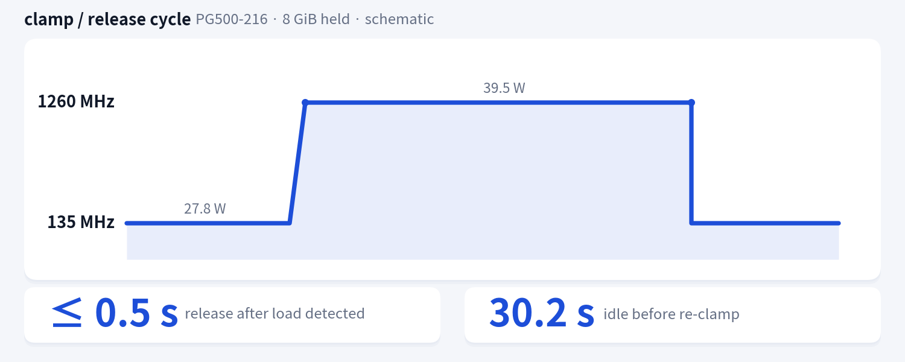
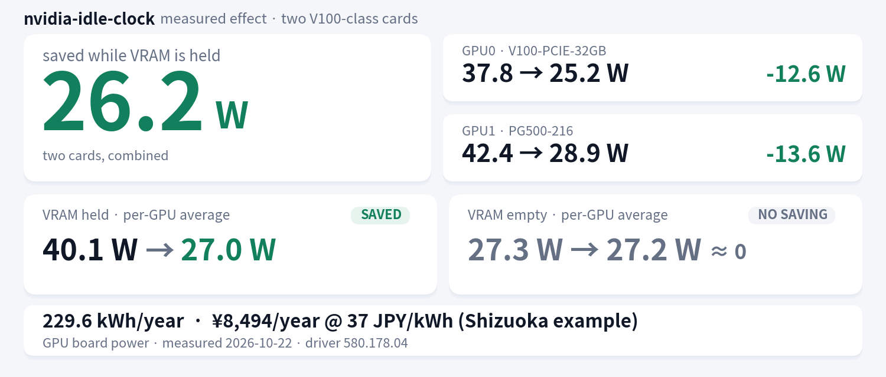

[← README に戻る](../README.md)

# nvidia-idle-clock リファレンス

日本語 | [English](reference.en.md)

README から移した長いリファレンス。クイックインストールだけなら [README](../README.md) で足りる。

## 目次

- [概要](#概要)
- [通常との違い](#通常との違い)
  - [観測される違い](#観測される違い)
  - [変わらないもの](#変わらないもの)
  - [代償](#代償)
- [必要環境（詳細）](#必要環境詳細)
- [対応ハードウェア](#対応ハードウェア)
- [インストーラのオプション](#インストーラのオプション)
  - [手動インストール](#手動インストール)
- [デーモンのコマンドライン](#デーモンのコマンドライン)
- [GPU ごとの割り当て](#gpu-ごとの割り当て)
- [アンインストール](#アンインストール)
- [実測データ](#実測データ)
  - [アイドル消費電力](#アイドル消費電力)
  - [クランプ階段](#クランプ階段)
  - [クランプの性能影響](#クランプの性能影響)
  - [サンプルログ](#サンプルログ)
- [設定](#設定)
- [状態ディレクトリと排他](#状態ディレクトリと排他)
- [動作](#動作)
- [注意](#注意)
- [トラブルシュート](#トラブルシュート)
- [共有 GPU](#共有-gpu)
- [先行事例](#先行事例)
- [ライセンス](#ライセンス)

## 概要

VRAM に何か載ると高クロックに張り付いたままになる NVIDIA GPU 向け。
**アイドル時だけ** `nvidia-smi -lgc` でクロック上限を絞り、負荷を検出すると解除する systemd デーモン。
**GPU ごとに独立したインスタンス**として動き、1枚ずつ別々の設定を割り当てられる。
必須の依存は bash と `nvidia-smi` だけで、NVAPI も CUDA toolkit もビルドも要らない。

| 状態 | クランプなし | クランプ 135MHz | 差 |
|---|---|---|---|
| V100-PCIE-32GB / VRAM 約31GiB 保持 | 37.85W | **25.22W** | **−12.63W** |
| PG500-216 / VRAM 約31GiB 保持 | 42.43W | **28.85W** | **−13.58W** |
| VRAM 空 | 25.50W / 29.20W | 25.45W / 28.97W | −0.05W / −0.23W (ノイズ) |

4 × 600 秒サンプル (n≈1060–1067/GPU、stdev 0.05〜0.33W、`utilization.gpu` は全サンプルで 0.0)。
以前の VRAM 3.6GiB / 8GiB 保持での測定は 36.3W → 24.9W / 40.9W → 28.4W、その再測定は
25.1W / 28.5W で、上の値と整合する。計測条件と生データは [実測データ](#実測データ) を参照。

> **効くのは VRAM を保持している間だけ。**
> VRAM が空なら driver が自分で 135MHz まで落とすのでクランプは不要
> (実測でクランプ有無の差は 0.05W / 0.23W = ノイズ)。
> 逆に **VRAM を保持している間は driver が降りない** — PG500-216 (GPU1) + 8GiB で
> 1260MHz / 40〜41W のまま **180秒** 経過するのを確認済み。ここが唯一の対象。
> 既定のアイドルクロックはボードで異なる (実測: GPU0 1230MHz / GPU1 1260MHz)。
> 解除後の計算能力・メモリ帯域は **誤差 0.01%** で復帰する (PG500-216 / 8GiB 保持での実測)。

> **V100 (Volta) では PState 強制が使えない。**
> NVAPI の `NvAPI_GPU_SetForcePstate()` は、検証環境 (driver **580.178.04**) では
> `fallback=0` で全 PState (8〜15) が `NVAPI_ERROR` を返す。この制限は上流の
> [nvidia-pstated issue #6](https://github.com/sasha0552/nvidia-pstated/issues/6) (2025年1月) で
> 既に分析され、V100 での実測も報告されている。
> リリース済みの [nvidia-pstate](https://github.com/sasha0552/nvidia-pstate) /
> [nvidia-pstated](https://github.com/sasha0552/nvidia-pstated) **v1.0.9 (2025-08-30)** は P-State 強制のみで、
> V100 では動作しない (同じ環境で `fallback=2` にすると 555MHz に固定され、driver の自然アイドル
> 135MHz より +3W 悪化した)。単一 P-State の GPU 向けのクロックロックは nvidia-pstated の
> [PR #10](https://github.com/sasha0552/nvidia-pstated/pull/10) で提案中 (2026-10-22 時点で未マージ)。
> そのため本プロジェクトは PState ではなくクロック範囲ロックを使う。

## 通常との違い



| | 通常 (driver 任せ) | 導入後 |
|---|---|---|
| VRAM 保持中・無負荷のクロック | 1230〜1380MHz のまま降りない (GPU0 1230 / GPU1 1260MHz) | **135MHz** (30秒無負荷で) |
| そのときの電力 | 37.9〜42.4W | **25.2〜28.9W** |
| 負荷が来たとき | そのまま実行 | 次のサンプルで検出し、`nvidia-smi -rgc` の起動と driver の復帰を経て解除。タイムライン図の測定では 0.5 秒以内、カーネル内計測では 0.18〜0.22 秒で 1300MHz 到達 |
| 負荷が 30 秒途切れたとき | 高いクロックのまま | 135MHz に戻る |
| 解除直後に負荷が戻ったとき | — | `COOLDOWN_SECONDS` (既定 60 秒) の間は再クランプしない (解除は遅らせない) |
| VRAM が空のとき | driver が自分で 135MHz まで落とす | **何もしない** (同じ) |
| PState | P0 のまま | P0 のまま (変化なし) |

### 観測される違い

クランプ中は `clocks.current.graphics` が 135MHz になるのが唯一の外形的な差。
`PState` は P0 のまま、`clocks.max.graphics` も 1380MHz のままで、`-lgc` はレポートに現れない。

```
$ nvidia-smi --query-gpu=index,pstate,clocks.gr,clocks.max.gr,power.draw --format=csv
index, pstate, clocks.current.graphics [MHz], clocks.max.graphics [MHz], power.draw [W]
0, P0, 135 MHz, 1380 MHz, 25.22 W
1, P0, 135 MHz, 1380 MHz, 28.85 W
```

(ある時点の 1 サンプル。値は `IDLE_CAP=135` でクランプ中のもの)

### 変わらないもの

- PState (V100 は常に P0)
- プロセスの VRAM、CUDA コンテキスト、計算結果
- persistence mode、電力上限、PCIe リンク、ファン制御
- クロック上限 (解除後は 1380MHz まで戻る。停止時に `-rgc` するのは **自分がクランプした GPU
  だけ**で、「元のロックを復元」ではなく「既定値にリセット」。VRAM を保持していると数秒で
  driver 管理のクロックに戻る — [注意](#注意) を参照)

### 代償

**負荷検出から解除まで**は、次のサンプル周期 + `nvidia-smi -rgc` の起動 + driver のクロック復帰の
合計で、ハードな上限はない。既定値 (`SAMPLE_MS=200`) では次のようになる。

| 項目 | 実測 |
|---|---|
| サンプル周期 | 平均 200.7 / 201.1ms、最大 207.6ms (24 サンプル) |
| `nvidia-smi -rgc` の起動 | 30〜50ms (5 回) |
| 解除 → 1300MHz 到達 | 180 / 215 / 215ms (3 試行) |
| タイムライン図の注記 | 0.5 秒以内 |

つまり既定値でも **0.2〜0.5 秒**かかる。`SAMPLE_MS` を上げれば比例して伸びる。
NVML の利用率は 1/6〜1 秒の[窓平均](https://docs.nvidia.com/deploy/nvml-api/index.html)なので、
窓が 1 秒の製品では最悪 1.2 秒程度になる。

**短いリクエストはこの間ずっと 135MHz で走る。** クランプ中の計算能力は 0.089 倍 (約 11 倍遅い) なので、
解除が終わる前に終わるリクエストは丸ごと影響を受ける。カーネル内で SM クロックを測ったところ、
クランプ中に投入した処理は最初の 80 / 95 / 110ms (3 試行) が 126〜127MHz で、1300MHz に達したのは
180 / 215 / 215ms 後だった。0.5 秒の処理は 500ms のうち 185ms (37%) を 126MHz で走った。

- 20 秒ベンチの平均 (下記 −0.49%) は、この 0.2〜0.5 秒の停止を平均に埋もれさせる。
  影響の判断は上のレイテンシで行うこと。
- 負荷が 30 秒以上途切れない GPU ではクランプされない。ただしリクエスト駆動のサーバでも
  合間が 30 秒を超えればクランプする (実測: 稼働中の推論サーバで 24 時間に **141 回**)。
  不要なら `IDLE_SECONDS` を上げる (例: `120`)。
- デーモン自身のコスト: 約 **380 CPU 秒/日/インスタンス** (1 コアの約 0.44%)、RSS 17〜23MB。
  大半は `SAMPLE_MS=200` のポーリング。

## 必要環境（詳細）

- Linux + systemd (テンプレートユニット `nvidia-idle-clock@.service` を使う)
- NVIDIA driver と `nvidia-smi`。`-lgc` / `-rgc` が使えること (`nvidia-smi -h` に `-lgc` があること)
- Volta 以降 (sm70+)。`-lgc` は Volta 以降でのみ使える
- root (`-lgc` / `-rgc` は root 専用)
- bash 4.2+ と coreutils、util-linux の `flock` (任意: 無い場合は警告して GPU 排他だけ無効化)。
  それ以外の依存はない (NVAPI / CUDA toolkit / ビルド不要)

## 対応ハードウェア

| GPU | 状態 |
|---|---|
| Tesla V100-PCIE-32GB (sm70) | **検証済み** — レイテンシ測定とアイドル電力 (37.85W → 25.22W、VRAM 約31GiB 保持) |
| Tesla PG500-216 (GV100 32GB, sm70) | **検証済み** — クランプ梯子・性能測定とアイドル電力 (42.43W → 28.85W、VRAM 約31GiB 保持) |
| Tesla V100-SXM2 / V100-PCIE-16GB | 未検証 (同じ sm70 で 135MHz 下限も同じだが、実機確認はしていない) |
| その他の sm70 (Quadro GV100 など) | 未検証 |
| Volta より新しい世代 (Turing / Ampere / Ada / Hopper) | **非対応** — `-lgc` は使えるが、このプロジェクトでは検証していない (節電効果も未検証) |
| Volta より前の世代 (Pascal など) | **非対応** — `nvidia-smi` に `-lgc` が無い |

要求したクロック範囲は起動時に検証し、`IDLE_CAP` がその GPU の `clocks.max.gr` を超える場合は
起動を拒否する。実行時に `-lgc` が拒否された場合は、ドライバのエラーを添えて警告し、
バックオフしながら再試行する (黙って「クランプした」ことにしない)。
`IDLE_CAP` / `MIN_CLK` の既定値 135MHz は V100 の下限なので、他のカードでは実機の下限に合わせる。

## インストーラのオプション

インストールは [README のクイックインストール](../README.md#クイックインストール) を参照。

**共有 GPU では、事前の合意なしに使わないこと** (`-lgc` はカード全体に効く。→ [共有 GPU](#共有-gpu))。

### 手動インストール

```bash
sudo install -m 0755 nvidia-idle-clock          /usr/local/sbin/nvidia-idle-clock
sudo install -m 0644 nvidia-idle-clock@.service /etc/systemd/system/nvidia-idle-clock@.service
sudo systemctl daemon-reload
sudo systemctl enable --now nvidia-idle-clock@0.service   # GPU 0
sudo systemctl enable --now nvidia-idle-clock@1.service   # GPU 1
```

`install.sh` は引数を GPU 名として扱う前に自分で解析する。

| オプション | 動作 |
|---|---|
| `-h`, `--help` | 使い方を表示して終了 |
| `-V`, `--version` | インストーラのバージョンとデーモンの sha256 を表示して終了 |
| `-n`, `--dry-run` | 実行内容を表示するだけで何も書き込まない (root 不要) |
| `--force` | ソースツリーの信頼チェックだけを省略する |
| `--gpus LIST` | GPU をカンマまたは空白区切りで指定 (繰り返し可) |
| `--` | 以降の引数を GPU として扱う |
| `[GPU ...]` | `nvidia-smi` の index、GPU UUID、MIG 識別子 |

`uninstall.sh`:

| オプション | 動作 |
|---|---|
| `-h`, `--help` | 使い方を表示して終了 |
| `-n`, `--dry-run` | 実行内容を表示するだけで何も変更しない |
| `--keep-clocks` | ユニットとファイルだけ削除し、クロック上限は保持する (デーモンの停止処理と `ExecStopPost --unlock` は `-rgc` を実行しない。下記参照) |

`--keep-clocks` を指定すると、`uninstall.sh` はユニットを止める前に
`${STATE_DIR:-/run/nvidia-idle-clock}/keep-clocks` を書く。デーモンの停止処理とユニットの
`ExecStopPost --unlock` はこのマーカーを尊重して `-rgc` を実行せず、`gpu<N>.locked` マーカーも
残したまま正常停止として扱う。そのためクランプはアンインストール後も再起動、または明示的な
`nvidia-smi -rgc` まで残る。アンインストールに失敗した場合は keep-clocks マーカーを削除する。
`uninstall.sh` は `STATE_DIR` も尊重するので、既定以外の状態ディレクトリでも同じように動く。

どちらも書き込む前に対象を検証する。`install.sh` の preflight は必須コマンド
(`nvidia-smi`, `systemctl`, `install`, `sha256sum`, `stat`, `cp`, `cmp`, `date`) と
systemd の動作、ソースファイルの存在を確認し、引数エラーは exit 2、環境エラーは exit 1 で
「何も書き込まずに」終了する。書き込み開始後に失敗した場合は rollback が走り、作成した
ファイルを削除し、置き換えたファイルをタイムスタンプ付きバックアップ
(`<path>.bak.<YYYYMMDDTHHMMSS>`) から復元する。

- 既存ファイルを置き換えるときは必ず `.bak.<timestamp>` を残す (同じ秒に 2 回実行した
  場合は PID を足す)。
- 稼働中だったインスタンスは、ペイロードが変わったときだけ `systemctl try-restart` で
  新しいコードに切り替える。再起動に失敗した場合は exit 1 で報告するが、インストール済みの
  ユニットは残す。
- root で動かすチェックアウトは、root または sudo 実行ユーザーが所有し、world-writable で
  なく、共有グループ経由の group-writable でもないこと。満たさない場合は `--force` なしで
  拒否する (何も書き込まない)。
- `uninstall.sh` はユニットを止められなかった時点でファイルを残す (動いているデーモンを
  ユニットなしにしない)。削除後にファイルが消えたことを検証し、`-rgc` の成否も確認する
  (`--keep-clocks` のときは解除しない)。

## デーモンのコマンドライン

```
usage: nvidia-idle-clock [-h|--help] [-V|--version] [-n|--dry-run] [-u|--unlock]
```

| オプション | 動作 |
|---|---|
| `-h`, `--help` | 使い方を表示して終了 |
| `-V`, `--version` | `nvidia-idle-clock 0.2.2` を表示して終了 |
| `-n`, `--dry-run` | 設定を検証し、解決後のプランを表示して終了。`-lgc` / `-rgc` は呼ばない |
| `-u`, `--unlock` | マーカーのある GPU だけを `-rgc` で解除して終了 (下記) |
| なし | フォアグラウンドでデーモンとして動く (systemd `Type=simple`) |

`--help` / `--version` は設定検証より前に、`--dry-run` は設定検証と対象 GPU の解決の後、
最初の `-lgc` / `-rgc` より前に処理される。未知のオプションと位置引数は
`level=error msg="unknown argument"` と usage を stderr に出して **exit 2** で終了する。

`--unlock` は、SIGKILL・OOM・`TimeoutStopSec` 超過などでデーモン自身が解除できなかった
クランプの復旧用で、ユニットの `ExecStopPost` がこれを実行する。対象 GPU のうち
`$STATE_DIR/gpu<N>.locked` があるものだけを `-rgc` してマーカーを消す。
`${STATE_DIR}/keep-clocks` がある場合 (アンインストーラの `--keep-clocks`) は、何も解除せず
マーカーを残したまま終了する (exit 0)。何も無ければ exit 0、
`-rgc` に失敗した GPU があれば exit 1。生きているインスタンスが `flock` を持っている GPU は
`level=warn msg="gpu managed by another instance"` を出してスキップする。解除だけなので
`clocks.max.gr` の検証は行わない。

```
$ nvidia-idle-clock --dry-run
level=info msg="dry run" gpu=0 min_mhz=135 cap_mhz=135 idle_s=30 sample_ms=200 nvidia_smi=/usr/bin/nvidia-smi state_dir=/run/nvidia-idle-clock
level=info msg="would clamp when idle" gpu=0 after_idle_s=30 util_threshold_pct=0 min_mhz=135 cap_mhz=135 skip_if_low=1 cooldown_s=60
level=info msg="would unlock on use or exit" gpu=0 trigger=util,exit,startup only_if_marked=1
```

終了コード:

| code | 意味 |
|---|---|
| `0` | 正常停止 (SIGTERM / SIGINT)、または `--help` / `--version` / `--dry-run` / `--unlock` の成功 |
| `1` | 実行時エラー (対象 GPU なし、`nvidia-smi` が見つからない、ストリーム停止、解除失敗など) |
| `2` | 設定値の不正、または不明な引数 |
| `3` | 対象 GPU を既に別のインスタンスが管理している (何も触っていない) |

設定値の検証は GPU に触る前に行われ、不正なら `level=error msg="invalid config"` を出して
exit 2、`nvidia-smi` が見つからなければ exit 1 で終了する。exit 3
(`msg="gpu already managed"`) は設定ミスなので、ユニットは `RestartPreventExitStatus=3` で
再起動しない。

## GPU ごとの割り当て

インスタンス名がそのまま対象 GPU (`nvidia-smi` index) になる。
任意の GPU に割り当てたい場合や、GPU ごとに違う設定にしたい場合は drop-in で上書きする。

```bash
sudo systemctl edit nvidia-idle-clock@0.service
```

```ini
[Service]
Environment=GPU=2            # 別の GPU に割り当てる
Environment=IDLE_CAP=555     # この GPU だけクランプを緩める
Environment=IDLE_SECONDS=120
```

```bash
sudo systemctl restart nvidia-idle-clock@0.service
```

**`GPU=` に既存インスタンスと同じ GPU を指定しないこと。** 対象 GPU は `flock` で排他され、
2 つ目のインスタンスは `level=error msg="gpu already managed"` を出して **exit 3** で終了する
(`RestartPreventExitStatus=3` なので再起動ループにもならない)。既定ではインスタンス名 =
GPU index なので、通常は重複しない。

例:

| インスタンス | GPU | 用途 |
|---|---|---|
| `nvidia-idle-clock@0.service` | 0 | 既定 (`IDLE_CAP=135`) |
| `nvidia-idle-clock@1.service` | 1 | drop-in で `IDLE_SECONDS=120` など |

## アンインストール

```bash
cd nvidia-idle-clock
sudo ./uninstall.sh
```

手動:

```bash
sudo systemctl disable --now 'nvidia-idle-clock@*'
sudo rm -f /etc/systemd/system/nvidia-idle-clock@.service /usr/local/sbin/nvidia-idle-clock
sudo systemctl daemon-reload
for g in $(nvidia-smi --query-gpu=index --format=csv,noheader); do sudo nvidia-smi -i "$g" -rgc; done
```

## 実測データ

計測環境: Tesla V100-PCIE-32GB + Tesla PG500-216 (GV100 32GB x2) / driver 580.178.04 / NVLink なし。
特記なき限り 20 秒平均。電力は GPU ボードのセンサー値 (`power.draw`) で、PSU 損失・CPU・
ディスクは含まない。旧測定の VRAM 保持は CUDA コンテキストで 3.6GiB / 8GiB。新しい A/B 測定は
推論サーバが約 31GiB/GPU を保持した状態 (GPU 自体はアイドル)。

26 時間の実運用でのクランプ時間率は 77.6% / 71.0% (GPU0 / GPU1)、24 時間のクランプ回数は 141 回。

### アイドル消費電力

VRAM 状態で効き目が変わる。



**測定方法.** 4 × 600 秒のサンプル、`nvidia-smi --loop-ms=500`、最初の 60 秒は捨てる。
1 GPU あたり n≈1060–1067 サンプル、stdev 0.05〜0.33W。全サンプルで `utilization.gpu` は
平均・最大とも 0.0% (GPU はアイドル、推論サーバは VRAM を保持しているだけ)。
A1/A2、B1/B2 は同じボードの隣接ペアの差分なので、熱ドリフトは相殺される。

| 状態 | GPU0 (V100-PCIE-32GB) | GPU1 (PG500-216) | 合計 |
|---|---|---|---|
| VRAM 保持 (約31GiB/GPU)、135MHz クランプ (A1) | 25.22W | 28.85W | 27.04W |
| VRAM 保持、クランプなし (driver 1230/1260MHz) (A2) | 37.85W | 42.43W | 40.14W |
| **VRAM 保持中の節電** | **12.63W** | **13.58W** | **26.21W** |
| VRAM 空、クランプなし (B1) | 25.50W | 29.20W | 27.35W |
| VRAM 空、クランプあり (B2) | 25.45W | 28.97W | 27.21W |
| **VRAM 空のときの節電** | **0.05W** | **0.23W** | **0.28W ≈ 0 (ノイズ)** |

- **効くのは VRAM 保持中だけ。** VRAM が空なら driver が自分で 135MHz まで落とすので、
  クランプの有無で差は出ない (0.05W / 0.23W はノイズ)。VRAM を保持している間は driver が
  降りないため、ここだけが対象になる。
- 既定のアイドルクロックはボードで異なる (実測: GPU0 1230MHz、GPU1 1260MHz)。
  「1260MHz」は GPU1 (PG500-216) の値で、両方に当てはまる値ではない。
- 両カード合計の削減量 26.21W を 1 年中使えた場合 **229.6kWh/年**。アイドル時間率
  25/50/75/100% では **57.4 / 114.8 / 172.2 / 229.6kWh/年**。
- 電気代は中部電力 従量電灯B の 300kWh 超の従量単価 (燃料費調整額・再エネ賦課金込み、
  2026-11-01 適用) **37 円/kWh** で **約 8,494 円/年**。2026-10-31 までは **32.89 円/kWh** で
  **7,551 円/年**。静岡での例で、燃料費調整額は毎月変わる。
- 条件: driver 580.178.04、V100 クラス 2 枚、NVLink なし、GPU ボード電力のみ
  (PSU 損失・CPU・ディスクは含まない)。数値は同じボードの隣接ペアの差分。

### クランプ階段

(PG500-216 / VRAM 8GiB 保持中, 各20秒)


| クランプ | 実クロック | 電力 |
|---|---|---|
| なし | 1260 MHz | 40.94 W |
| `-lgc 135,555` | 555 MHz | 31.73 W |
| `-lgc 135,300` | 300 MHz | 29.52 W |
| `-lgc 135,135` | 135 MHz | 28.40 W |

### クランプの性能影響

(PG500-216 / VRAM 8GiB 保持)


| 項目 | クランプなし | 135MHz クランプ中 | 解除後 | 実運用パス\* |
|---|---|---|---|---|
| DtoD copy | 1024.7 GB/s | 198.7 GB/s | 1024.6 GB/s | 1019.7 GB/s (−0.49%) |
| memset | 1114.9 GB/s | 133.8 GB/s | 1114.9 GB/s | 1114.8 GB/s (−0.01%) |
| SGEMM 4096 (FP32) | 12.36 TFLOP/s | 1.10 TFLOP/s | 12.36 TFLOP/s | 12.36 TFLOP/s (±0%) |

\* クランプ状態に負荷投入 → デーモンが自動解除した場合 (20秒予算)

> **測定ボードについて。** VRAM 8GiB 保持の測定はすべて **PG500-216** (GV100 32GB) で、クランプ階段と性能影響の図はこの実行のもの、アイドル電力の A/B は 2026-10-22 の測定。

### サンプルログ

タイムスタンプは journald が付けるので、スクリプト自身は出力しない。既定値
(`IDLE_SECONDS=30`, `SAMPLE_MS=200`, `COOLDOWN_SECONDS=60`) での 1 サイクル:

```
$ journalctl -u nvidia-idle-clock@0 -o cat
level=info msg="no stale clamp markers" gpu=0 state_dir=/run/nvidia-idle-clock
level=info msg="started" gpu=0 min_mhz=135 cap_mhz=135 idle_s=30 sample_ms=200 util_threshold_pct=0 reassert_s=30 skip_if_low=1 cooldown_s=60 state_dir=/run/nvidia-idle-clock nvidia_smi=/usr/bin/nvidia-smi
level=info msg="clamp verified" gpu=0 trigger=idle was_mhz=1230 observed_mhz=135 min_mhz=135 cap_mhz=135
level=info msg="unlocked" gpu=0 trigger=util util_pct=42
level=info msg="clamp delayed" gpu=0 reason=cooldown remaining_s=30 cooldown_s=60
level=info msg="exit" gpu=0 rc=0
# ユニットの ExecStopPost (--unlock)
level=info msg="unlock done" gpu=0 released=none rc=0
```

クランプが残った場合の復旧経路:

```
# 停止時にユニットの ExecStopPost が実行する (--unlock)
level=info msg="unlocked" gpu=0 trigger=unlock
level=info msg="unlock done" gpu=0 released=0 rc=0

# マーカーが残ったまま次回起動した場合
level=info msg="stale clamp markers found" gpu=0 state_dir=/run/nvidia-idle-clock action=release
level=info msg="unlocked" gpu=0 trigger=startup
```

同じ GPU を 2 つのインスタンスが管理しようとした場合:

```
level=error msg="gpu already managed" gpu=1 hint="another instance holds /run/nvidia-idle-clock/gpu1.lock"
```

- `level=` と `msg="..."` が先頭の 2 フィールド。`msg` は固定の識別子なので、自由文ではなく
  `msg="..."` で grep する。
- `level=` は syslog priority ではないため `journalctl -p warning` では絞れない。
  `journalctl -u nvidia-idle-clock@0 -g 'level=(warn|error)'` を使う。
- デーモン自身の最後の行は `msg="exit" rc=0`。そのあとにユニットの `ExecStopPost`
  (`--unlock`) が `msg="unlock done"` を出す。解除に失敗した場合は `msg="unlock failed"` の
  あとに `msg="exit" rc=1` が続く。
- `msg="gpu already managed"` は exit 3。ユニットは `RestartPreventExitStatus=3` なので
  再起動しない。
- `msg="clamp delayed"` は `COOLDOWN_SECONDS` による正常な抑制で、エラーではない。
- `was_mhz` は GPU の既定アイドルクロック (実測: GPU0 1230MHz / GPU1 1260MHz)。
  ボードによって異なるので、単一の 1260MHz を前提にしないこと。

## 設定

インスタンスごとに `Environment=` で指定する。`%i` (インスタンス名) が既定の GPU。

| 変数 | 既定 | 説明 |
|---|---|---|
| `GPU` | `%i` | 対象 GPU (nvidia-smi index, カンマ区切り可) |
| `IDLE_CAP` | `135` | アイドル時にクランプする上限クロック MHz |
| `MIN_CLK` | `135` | 下限クロック MHz |
| `IDLE_SECONDS` | `30` | この秒数無負荷でクランプ |
| `SAMPLE_MS` | `200` | 利用率サンプリング間隔 ms |
| `UTIL_THRESHOLD` | `0` | これ以下の利用率をアイドルとみなす % |
| `REASSERT_SECONDS` | `30` | クランプ再適用の間隔 s |
| `SKIP_IF_LOW` | `1` | 既に低クロックでアイドル中の GPU にはクランプしない |
| `COOLDOWN_SECONDS` | `60` | 解除後、この秒数は同じ GPU を再クランプしない (0 で無効。解除は遅らせない) |
| `STATE_DIR` | `/run/nvidia-idle-clock` | マーカーと `flock` のディレクトリ (デーモンが 0700 で作成) |
| `NVSMI` | `PATH` 上の `nvidia-smi` | 使う `nvidia-smi` のパス (テスト・特殊な配置用) |

`GPU` に存在しない index を指定した場合は除外して警告を出す。全部無効なら起動に失敗する。
設定値が不正なら `msg="invalid config"` を出して exit 2、`nvidia-smi` が見つからなければ exit 1 で
終了する (どちらも GPU に触る前)。同じ GPU を既に別インスタンスが管理している場合は
`msg="gpu already managed"` を出して exit 3 で終了する。

## 状態ディレクトリと排他

クランプはプロセスの外に状態を残す。

- `STATE_DIR` (既定 `/run/nvidia-idle-clock`) に GPU ごとのファイルを置く。デーモンが
  mode 0700 で作成する。
  - `gpu<N>.locked` — クランプ要求の前に書く復旧用マーカー。解除で消える。適用を確認できなかった
    場合も解除対象として残す。
  - `gpu<N>.lock` — `flock` の対象。排他用。
- マーカーは「このプロセスがこの GPU をクランプした (可能性がある)」という唯一の記録。
  プロセスが落ちても残るので、次回起動時と `--unlock` はマーカーのある GPU だけを解除できる。
  逆に、マーカーの無い GPU は他ツールのロックかもしれないので触らない。
- 同じ GPU を 2 つのインスタンスが指すと、2 つ目は `flock` を取れず
  `msg="gpu already managed"` で exit 3。ユニットは `RestartPreventExitStatus=3` なので
  再起動しない。
- 停止時はユニットの `ExecStopPost=-/usr/local/sbin/nvidia-idle-clock --unlock` が走る。
  EXIT トラップが実行できない SIGKILL・OOM・`TimeoutStopSec` 超過でも、マーカーのある GPU を
  解除できる。
- ユニットは `ProtectSystem=strict` で `/run` も読み取り専用になるため、`ReadWritePaths=/run`
  と `ReadOnlyPaths=/run/systemd /run/udev /run/log` を設定してマーカーを書けるように
  している。`ReadWritePaths=/run/nvidia-idle-clock` はディレクトリが存在しない初回起動で
  ユニットごと失敗する (`226/NAMESPACE`) ため使えない。`RuntimeDirectory=` も使わない
  (停止時に消えてしまい、`--unlock` が読むマーカーが残らない)。
- `flock` が無い環境では警告して排他だけ無効化する (デーモン自体は起動する)。

## 動作

- 対象 GPU の利用率を `SAMPLE_MS` 間隔で監視 (インスタンスごとに独立)
- `IDLE_SECONDS` 無負荷 → `nvidia-smi -i N -lgc MIN_CLK,IDLE_CAP`
- クランプ後の読み戻しで `clocks.gr` が空・`[N/A]`・上限超えになり適用を確認できなかった場合は、
  ロックされている可能性があるものとして解除対象に残す。負荷検出時・利用率が読めないサンプル・
  終了時に解除し、ジャーナルには `msg="clamp unverified" ... action="release-retry"` を出す
- 利用率 > `UTIL_THRESHOLD` → `-rgc` で解除 (`COOLDOWN_SECONDS` 中でも解除は即時)
- `SKIP_IF_LOW=1` のとき既に低クロックなら何もしない (VRAM が空なら不要なため)
- 利用率ストリームが `max(5秒, 5×SAMPLE_MS)` のあいだ途切れたら、その `nvidia-smi` を停止して
  exit 1 で終了する (`msg="utilization stream stale"`)。systemd は `Restart=on-failure` で再起動する
- 起動時に `/dev/nvidiactl` が無い場合は起動条件でスキップせず、`ExecStartPre` の失敗として
  `Restart=on-failure` が 30 回 / 600 秒の予算 (約 5 分) で再試行する。ドライバの準備が遅れても
  サービスが黙ってスキップされたままにならない
- ストリームが終了した場合は 2 秒後から指数バックオフ (2→30 秒) で再接続し、最初の stderr 行を
  `msg="stream lost"` に載せる。60 秒以内に 5 回失敗したら
  `msg="utilization stream unavailable"` で exit 1
- 非数値の利用率 (`[N/A]`) は「利用不可」として扱う。クランプ中なら解除し (安全側)、
  アイドル時間はリセットし、警告は streak ごとに 1 回だけ出す
- 解除後 `COOLDOWN_SECONDS` (既定 60 秒) は同じ GPU を再クランプしない。短いクランプ/解除の
  繰り返しを防ぐためで、`0` で無効化できる
- 起動時は、前回のクランプが残したマーカーがある GPU だけを `-rgc` で解除する。マーカーの
  無い GPU には触れないので、他ツールが設定したクロックロックを起動だけで消すことはない
- 起動時に残存マーカーの解除に失敗した場合も、その GPU を解除対象に残してビジーになった時点で
  再試行する (ジャーナルには `msg="startup unlock failed" ... action="retry-on-activity"` を出す)
- 停止時は自分がクランプした GPU だけを `-rgc` で解除する。SIGKILL・OOM・`TimeoutStopSec`
  超過で trap が走らなくても、ユニットの `ExecStopPost` が `--unlock` を実行し、マーカーの
  ある GPU を解除する
- 同じ GPU を別インスタンスが管理している場合は起動せず exit 3
  (`RestartPreventExitStatus=3`)

## 注意

- クランプは **カード全体 (デバイス全体)** に効く。変更・解除は root のみ。
  共有 GPU では [共有 GPU の注意](#共有-gpu) を必ず読むこと。
- 効くのは VRAM 保持中だけ。VRAM が空の GPU では何もしない (driver が 135MHz まで落とす)。
- クランプ中は計算 0.089 倍 / 帯域 0.12〜0.19 倍まで落ちる。解除までの時間は
  「次のサンプル周期 + `-rgc` の起動 + driver の復帰」で、既定 0.2〜0.5 秒。`SAMPLE_MS` に比例する。
- VRAM を保持したまま常時推論している GPU ではアイドル判定が来ないため効かない。
  ただし合間が 30 秒を超えるリクエスト駆動のサーバではクランプする (実測 141 回/24 時間)。
- 複数の P-State を持つ世代 (P40 など) では P-State 強制の方が向いている場合がある。
  [nvidia-pstate](https://github.com/sasha0552/nvidia-pstate) /
  [nvidia-pstated](https://github.com/sasha0552/nvidia-pstated) が該当する。
  上流の README には消費電力の数値が無く、当方で P40 を測ったこともないため、
  このドキュメントからは数値を引用しない。
- 解除直後は `COOLDOWN_SECONDS` (既定 60 秒) の間クランプしない。短いアイドルが続く間は
  その分の節電が無い。`0` で無効化でき、解除そのものは cooldown で遅れない。
- `-rgc` は driver 既定のポリシーに戻すだけで、低クロックを強制しない。VRAM を保持していると
  数秒で driver 管理のクロックまで戻る (PG500-216 / 8GiB 保持・既定 1260MHz での実測:
  135MHz / 28.51W → 3 秒後に 1260MHz / 38.97W、10 秒平均 28.51W → 40.31W、
  **+11.8W / +29.3%**)。クランプによる節電は、解除後の `COOLDOWN_SECONDS` (既定 60 秒) と
  次のアイドル判定が終わるまで失われる。ロックが無い、または VRAM が空のときだけ no-op。

## トラブルシュート

症状から該当節を引く。

- クランプされない → [概要](#概要) の適用条件、[設定](#設定) の `IDLE_SECONDS` / `SKIP_IF_LOW`
- 解除されない・クランプが残った → [状態ディレクトリと排他](#状態ディレクトリと排他) の `--unlock` と `ExecStopPost`
- `gpu already managed` で exit 3 → [GPU ごとの割り当て](#gpu-ごとの割り当て)
- ログの読み方・`level=` の絞り込み → [サンプルログ](#サンプルログ)
- 終了コードの意味 → [デーモンのコマンドライン](#デーモンのコマンドライン)
- ブート後にユニットが `failed` → `journalctl -u nvidia-idle-clock@0` で `/dev/nvidiactl` の
  `ExecStartPre` チェックを確認する。ドライバが起動したら
  `systemctl reset-failed nvidia-idle-clock@0.service` のあと
  `systemctl start nvidia-idle-clock@0.service` を実行する
- 共有 GPU での危険 → [共有 GPU](#共有-gpu)

## 共有 GPU

**合意のない共有 GPU では使わないこと。** `-lgc` はカード全体のクロック上限で、プロセス単位ではない。

- 変更・解除は root だけができる。非 root の同居テナントは `-lgc` も `-rgc` も実行できず
  (exit 4)、自分ではクランプを解除できない。
- **同居テナントはクランプされていることを知ることすらできない。** ロックは
  `nvidia-smi -q -d CLOCK` にも `nvidia-smi -q` のどの項目にも出ない。見えるのは
  `clocks.current.graphics` が 135MHz になっていることだけ。
- カードの利用率が 0 の間、同じカードの全プロセス・全コンテキストが 135MHz で走る
  (MIG のコンピュートインスタンスもクロックを共有する)。解除は次のサンプル周期 + `-rgc` 起動 +
  driver 復帰 (既定 0.2〜0.5 秒) 後。
- `Environment=GPU=` の重複で 2 つのインスタンスが同じカードを指すと、2 つ目は起動時に
  `msg="gpu already managed"` を出して exit 3 で終了する (`flock` による排他)。
  `RestartPreventExitStatus=3` なので再起動ループにはならない。
- 自分の管理下のカード (ワークステーション、単独利用の推論サーバ) でのみ使うこと。

## 先行事例

アイドル時にデータセンター GPU のクロックを絞る、という発想自体は新しくない。
本プロジェクトはそれを「依存なしの小さな実装」として提供するもので、最初でも唯一でもない。
以下は同じ問題に対する先行・関連実装で、GPU によってはこちらの方が適切な場合がある。

- **[sasha0552/nvidia-pstated](https://github.com/sasha0552/nvidia-pstated)** (GPL-3.0) —
  この分野の参照実装。NVAPI で P-State を強制し、アイドル時に自動で切り替える。
  複数の P-State を持つ P40 系のカードならこちらが適切。オープンな
  **[PR #10](https://github.com/sasha0552/nvidia-pstated/pull/10)** は **V100** を含む単一 P-State の
  GPU 向けに、NVML でクロックをロックする `--clock-mode` を追加するもの (2026-09-12 時点で
  メンテナのレビュー中・コミットあり、未マージ)。マージされれば本リポジトリと同等のことを
  より高機能に行うので、まずそちらを確認してほしい。
  V100 で P-State 強制が効かない点と、クロックロックによる V100 の実測は
  **[issue #6](https://github.com/sasha0552/nvidia-pstated/issues/6)** (2025年1月) で既に検討済み。
- **[sasha0552/nvidia-pstate](https://github.com/sasha0552/nvidia-pstate)** (MIT) — 上記の前身の
  CLI / Python ライブラリ。P-State を手動で切り替える。
- **[dqs105/nvidia-powermizer](https://github.com/dqs105/nvidia-powermizer)** (GPL-3.0) —
  利用率連動でクロックを絞るデーモン (対象はメモリクロック)。ヒステリシス付き。
- **[UzixLS/cmp50hx-unlock の idle-governor](https://github.com/UzixLS/cmp50hx-unlock/blob/master/idle-governor/README.md)**
  — CMP 50HX 向けの同種の制御ループ。`-lgc` の範囲指定では下がらない場合がある、という
  実測が参考になる。
- **[mu-b/ai-dgxspark-power](https://github.com/mu-b/ai-dgxspark-power)** — `-lgc` をスケジュールで
  適用し、定期的に再適用する (GB10 向け)。
- **[andyljones/coolgpus](https://github.com/andyljones/coolgpus)** (MIT) /
  **[LACT](https://github.com/ilya-zlobintsev/LACT)** (MIT) — ファン・電力上限側の隣接ツール。
  アイドル時のクロックは触らない。

NVIDIA 純正機能では実現できない。`nvidia-persistenced` はドライバを常駐させるだけで
([docs](https://docs.nvidia.com/deploy/driver-persistence/persistence-daemon.html))、
`nvidia-powerd` はノート PC で電力を上乗せする方向
([docs](https://download.nvidia.com/XFree86/Linux-x86_64/580.76.05/README/dynamicboost.html))、
`-lgc` にアイドル連動機能は無い ([man](https://man.archlinux.org/man/nvidia-utils/nvidia-smi.1.en))。

本プロジェクトの差分は次の 4 点。

- **既存の非標準依存が無い** — bash と `nvidia-smi` だけ。NVAPI ライブラリも CUDA toolkit も
  ビルドも要らない
- **GPU ごとの systemd テンプレートインスタンス** — `nvidia-idle-clock@N.service` と
  drop-in で、カードごとに別の設定を持てる
- **MIT ライセンス** — 上記の主要な先行実装は GPL-3.0
- **実測を出典付きで載せている** — クランプ梯子、解除後の復帰、レイテンシ、デーモン自身のコスト

## ライセンス

MIT
